  <a href="https://suman-kim.github.io"><picture>
    <source media="(prefers-color-scheme: dark)" srcset="./assets/banner-dark.svg">
    
  </picture></a>

완성된 작업과 경력은 [포트폴리오](https://suman-kim.github.io)에, 지금 개발하고 있는 것과 일하는 과정은 여기에 기록합니다.

  
  
  

  <picture>
    <source media="(prefers-color-scheme: dark)" srcset="./assets/now-dark.svg">
    
  </picture>

  <picture>
    <source media="(prefers-color-scheme: dark)" srcset="./assets/ai-loop-dark.svg">
    
  </picture>

  <picture>
    <source media="(prefers-color-scheme: dark)" srcset="./assets/exploring-dark.svg">
    
  </picture>

  <picture>
    <source media="(prefers-color-scheme: dark)" srcset="./assets/homelab-dark.svg">
    
  </picture>

  <picture>
    <source media="(prefers-color-scheme: dark)" srcset="./assets/activity-dark.svg">
    
  </picture>

### Latest Posts

<!-- BLOG-POST-LIST:START -->- [2026년 2회 정보처리기사 실기 후기](https://ssirioops.tistory.com/45) 2026.08.01
- [60회 SQLD 자격증 시험 후기](https://ssirioops.tistory.com/43) 2026.03.08
- [4. SQL 활용](https://ssirioops.tistory.com/42) 2026.03.08
- [3. SQL 기본](https://ssirioops.tistory.com/41) 2026.03.08
- [2. 데이터 모델과 SQL](https://ssirioops.tistory.com/40) 2026.03.08
<!-- BLOG-POST-LIST:END -->
